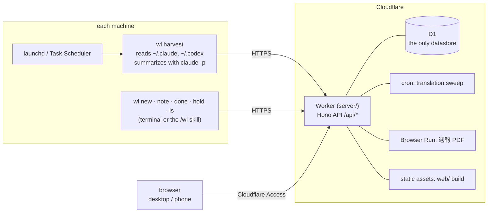

<div align="center">

<a href="https://hakupao.github.io/worklog-public/"></a>

# worklog

**A work log that writes itself.**<br>
Claude Code and Codex sessions are collected in the background, matched to the tasks you are working on,
and turned into a weekly report in Japanese, Chinese and English.

<a href="https://hakupao.github.io/worklog-public/"></a>

[](https://github.com/hakupao/worklog-public/actions/workflows/ci.yml)
[](https://github.com/hakupao/worklog-public/actions/workflows/pages.yml)
[](LICENSE)


English · [简体中文](README.zh-CN.md) · [Usage guide](docs/guide/usage.md) · [API](docs/guide/api.md)

</div>

> [!TIP]
> **The demo is the real app.** The Worker's own code runs inside your browser on an in-memory SQLite database
> filled with eight weeks of made-up work: 434 sessions on two machines, 15 tasks, plans, weekly digests and
> reviews in three languages. The clock starts at Thursday 15 October 2026, 15:20 JST and keeps ticking. Click
> anything: edits stay in the tab and reset on reload.

## Two looks, one board

<table>
<tr>
<th width="50%">裏 · Back: LED dot matrix</th>
<th width="50%">表 · Front: print</th>
</tr>
<tr>
<td><a href="https://hakupao.github.io/worklog-public/?world=ura#/v2/now"></a></td>
<td><a href="https://hakupao.github.io/worklog-public/?world=omote#/v2/now"></a></td>
</tr>
</table>

Every page comes in both looks; switch with **Front · Back** in the dock. The Now page shows what is running,
what to do next (unlinked sessions, today's plan, the report not yet downloaded), today's run chart and an
ephemeris of weekends, paydays and holidays, under a dot-matrix scene that changes with the time of day.

## A tour

<table>
<tr>
<td width="50%"><a href="https://hakupao.github.io/worklog-public/#/v2/timeline"></a></td>
<td width="50%"><a href="https://hakupao.github.io/worklog-public/#/v2/plan"></a></td>
</tr>
<tr>
<td><b>Timeline</b>: every session of the week on one board, one coloured line per task. Link an unlinked
session to a task right there.</td>
<td><b>Plan</b>: daily, weekly, near and far lists, and today's plan, which a model checks against the day's
sessions (done / partly / not done).</td>
</tr>
<tr>
<td><a href="https://hakupao.github.io/worklog-public/?world=omote#/v2/tasks"></a></td>
<td><a href="https://hakupao.github.io/worklog-public/?world=omote&lang=ja#/v2/report"></a></td>
</tr>
<tr>
<td><b>Tasks</b> (案件): requester, status, hours per day and week, and which ones have a session running now.</td>
<td><b>週報</b>, the weekly report: digests per task and per day, editable cells, a one-page A4 PDF and a
cross-week xlsx, each in three languages.</td>
</tr>
</table>

<a href="https://hakupao.github.io/worklog-public/#/v2/stats"></a>

**Stats**: 24 views you can switch on, off and reorder: headline numbers, a day waterfall, parallel sessions,
rhythm, requesters, token use and API-equivalent cost, and a weekly AI review.

<table>
<tr>
<td width="34%"><a href="https://hakupao.github.io/worklog-public/?lang=ja#/m/now"></a></td>
<td width="34%"><a href="https://hakupao.github.io/worklog-public/?world=omote#/m/tl"></a></td>
<td>
<b>On your phone</b><br><br>
Narrow screens get their own shell: now, timeline, tasks, plan and stats, built for a glance between meetings.
<br><br>
Every screen also comes in 中文 and 日本語, including the data: titles, digests and notes are translated.
</td>
</tr>
</table>

> **Built for one person's workflow.** It was written for a dispatched engineer in Japan who logs work per request
> and hands in a weekly report (週報) in Japanese. The data model, the report layout and many UI terms follow that
> workflow, so some words stay Japanese:
> 案件 = task, 依頼元 = requester, 週報 = weekly report, 備考 = remarks, 対応中 / 保留 / 完了 = open / on hold / done.
> Dates and weeks are computed in Tokyo time (JST).

## What it does

- **Collects sessions.** `wl harvest` reads Claude Code (`~/.claude/projects`) and Codex (`~/.codex/sessions`) logs
  and sends one record per session: active time, files written, token usage, API-equivalent cost (from a price table
  in `config.toml`) and a short summary written by `claude -p`.
- **Links sessions to tasks.** Each session is matched to a task by its working directory (`[projects]` in
  `config.toml`) and dates. What cannot be matched stays *unlinked* until you link it on the timeline.
- **Tracks tasks and plans.** Tasks (案件) with requester, project, notes and deliverables. Deliverables are added by
  hand or detected from files the sessions wrote. A plan list (daily / week / near / far) and a day plan, which the
  model checks against the day's sessions at harvest time.
- **Writes the weekly report.** A preview with editable cells, per-day and per-week AI digests, a one-page A4 PDF
  (rendered by Cloudflare Browser Run, with a composer that picks rows and order), and a cross-week xlsx of up to 52
  weeks. All exports come in Japanese, Chinese or English.
- **Shows statistics.** 24 switchable views (hours, rhythm, requesters, token use and cost) and a weekly AI review
  written by `wl review`.
- **Trilingual UI** (zh / ja / en). The Worker translates user text with Claude and lightly polishes typed input,
  keeping the original. There is a desktop UI with a light and a dark (LED dot-matrix) look, and a phone UI.
- **`/wl` skill for Claude Code** (optional): create tasks, add notes and mark them done in plain language, without
  leaving the session.

## Architecture



- D1 is the single source of truth; nothing is kept locally except the collector's bookmarks and an outbox of
  unsent writes.
- The browser authenticates through a Cloudflare Access session and never holds a token. The CLI sends a bearer
  token plus an Access service token.

## Repository layout

| Path | What it is |
|------|------------|
| `collector/` | The `wl` CLI in Go: log parsers, summarizer, harvest, API client. `make -C collector build` puts the binary in `bin/`. |
| `server/` | The Cloudflare Worker: Hono API, D1 migrations, report builders (ExcelJS xlsx, PDF via Browser Run), cron jobs. |
| `web/` | The web UI: React, Vite, TanStack Query, ECharts. Built into `server/public/`. |
| `web/demo/` | The demo site: runs `server/src` in the browser on a sql.js stand-in for D1, with a generated fictional dataset (`demo/seed/`). Published to GitHub Pages by `.github/workflows/pages.yml`. |
| `scripts/` | Scheduler setup (launchd plist, Task Scheduler script), `/wl` skill installers, release and update scripts, the local digest writer. |
| `skills/wl/` | Template of the Claude Code `/wl` skill (rendered by `scripts/install-skill.*`). |
| `docs/` | `guide/` (usage and API) and `design/` (design documents). |
| `config.example.toml` | Example configuration; copy it to `config.toml`. |
| `.github/` | CI workflow, issue and pull request templates. |

## Quick start

You need a Cloudflare account (Workers, D1, Access; Browser Run for the PDF), Node 24, Go (the version in
`collector/go.mod`), and for summaries the [Claude Code](https://claude.com/claude-code) CLI, logged in.

### 1. Deploy the Worker

First set up **Cloudflare Access** for the hostname the Worker will use: a self-hosted application with an allow
policy for your login, and a service token with a *Service Auth* policy for the CLI. Note your team domain and the
application's AUD tag; the Worker verifies every Access JWT against them and refuses one it cannot verify.

Then, from the repository:

```bash
git clone https://github.com/hakupao/worklog-public.git
cd worklog/server
npm install
npx wrangler login
npx wrangler d1 create worklog          # note the database_id it prints
```

Edit `server/wrangler.jsonc` for your account:

- `routes`: your hostname (for example `worklog.example.com`), or remove `routes` and use the `workers.dev` URL;
- `d1_databases[0].database_id`: the id from `d1 create`;
- `vars.TEAM_DOMAIN` (`https://<team>.cloudflareaccess.com`) and `vars.POLICY_AUD` (the Access application's AUD tag);
- `vars.DIGESTS_AUTO`: `"on"` lets the Worker write the report digests itself; `"off"` leaves them to
  `scripts/digests-local.mjs`.

Set the secrets and deploy:

```bash
npx wrangler secret put API_TOKEN          # required: the CLI's bearer token
npx wrangler secret put ANTHROPIC_API_KEY  # optional: translation, polishing, digests, PDF text
npm run deploy                             # builds web/, applies D1 migrations (--remote), deploys
```

### 2. Build the CLI

From the repository root:

```bash
make -C collector build                 # -> bin/wl
```

On Windows, build with `make -C collector build-windows` and rename the output `bin/wl-windows-amd64.exe` to
`bin\wl.exe`, or download a release with `scripts/update-wl.ps1 -Tag <tag> -Dest bin -Repo <owner>/<repo>`. Releases
are made with `scripts/release-wl.sh`.

### 3. Configure

```bash
cp config.example.toml config.toml
```

In `config.toml`, set `api_url`, your `[requesters]` aliases and `[projects]` (absolute directory → project name).
`summarize_model` is the model `claude -p` uses for summaries (default `haiku`).
Secrets and per-machine values go under `~/.worklog/`, never into the repository:

```toml
# ~/.worklog/credentials.toml
api_token = "..."
access_client_id = "..."        # Cloudflare Access service token
access_client_secret = "..."
```

```toml
# ~/.worklog/local.toml (optional)
machine = "laptop"              # overrides `machine` in config.toml; the default is the hostname
```

`wl` looks for `config.toml` in `$WORKLOG_ROOT`, else in the current directory and its parents, else in the
binary's directory and its parents, so `bin/wl` works from anywhere. `$WORKLOG_HOME` replaces `~/.worklog`.

### 4. First harvest

```bash
bin/wl harvest
```

A good run exits 0 and ends with a line like `new=12 updated=0 parked=0 skipped=3 fallback=0, unassigned=4`, and
the machine's name appears in the web UI's top bar. `fallback=N` means `claude -p` was not available, so N sessions
got a placeholder summary.

### 5. Run it on a schedule

There is no daemon; a scheduler runs `wl harvest`.

- **macOS**: `scripts/com.worklog.harvest.plist` runs `bin/wl harvest --tiered` at :00, :15, :30 and :45. Replace
  the placeholder paths (`ProgramArguments`, `PATH` so that `claude` is found, `WORKLOG_ROOT`, `WorkingDirectory`),
  then:

  ```bash
  cp scripts/com.worklog.harvest.plist ~/Library/LaunchAgents/
  launchctl load ~/Library/LaunchAgents/com.worklog.harvest.plist
  ```

- **Windows**: `scripts/schtasks-harvest.ps1` registers the task `WorklogHarvest`, which runs a full
  `bin\wl.exe harvest` every hour at :00 without opening a window. Output goes to
  `%USERPROFILE%\.worklog\harvest.log`.

`--tiered` is meant for a 15-minute scheduler. Each run reads only the logs that changed and does only the work
that is due:

| Tier | Work |
|------|------|
| 15 min | flush the outbox, send changed sessions, summarize new sessions, heartbeat |
| 1 hour | re-summarize active sessions (and once more when they stop), today's plan check, deliverable check |
| 1 day | yesterday's final plan check, a full 14-day rescan |
| 1 week | the weekly review |

An idle run makes no `claude` call. A plain `wl harvest` reads everything and does all of it. See
[`docs/design/2026-10-20-tiered-harvest-design.md`](docs/design/2026-10-20-tiered-harvest-design.md).

### 6. Optional: the `/wl` skill

```bash
./scripts/install-skill.sh          # macOS (needs bin/wl)
.\scripts\install-skill.ps1         # Windows PowerShell (needs bin\wl.exe)
```

This renders `skills/wl/SKILL.template.md` with this checkout's paths into `~/.claude/skills/wl/SKILL.md`. Re-run
it after you move the repository or edit the template.

## CLI

| Command | What it does |
|---------|--------------|
| `wl new REQUESTER TITLE [--project P] [--received YYYY-MM-DD]` | Create a task; prints the id the server allocated (`T20260918-01`). |
| `wl note TASK_ID TEXT [--minutes N]` | Add a note and append it to the task's 備考. Use `-` as `TASK_ID` for a note with no task. |
| `wl done TASK_ID [--deliverable PATH]... [--hours H]` | Mark a task done. |
| `wl hold TASK_ID` | Put a task on hold. |
| `wl ls [--all]` | List open and on-hold tasks (`--all` includes done ones). |
| `wl harvest [--tiered] [--since DAYS] [--claude-root PATH] [--codex-root PATH]` | Collect session logs and send them. `--since` defaults to 14 days. |
| `wl harvest --refresh-meta [--since DAYS]` | Only refresh files written, token usage and cost of sessions already sent. |
| `wl review [--week YYYY-Www] [--force]` | Write the weekly AI review (default: last week). |
| `wl plan judge [--date YYYY-MM-DD]` | Check a day plan against that day's sessions now (default: today). |

Linking sessions to tasks, editing and the report all happen in the web UI.

**How writes behave.** Every write goes straight to the API.

- `wl new`, `wl done` and `wl hold` either reach the server or exit 1. They are never queued, so an error always
  means nothing changed.
- `wl note` is queued in `~/.worklog/outbox/` when the server is unreachable, and the next `wl harvest` sends it.
  Sessions that cannot be sent are queued the same way (`parked=N`). Writes the server rejects move to
  `outbox/rejected/` and are not retried.
- `wl harvest` exits 2 when it cannot read the task list (it would otherwise send every session as unlinked).
  It also exits 2 when another harvest holds `~/.worklog/harvest.lock`; with `--tiered` that case exits 0.
- There is no version check between reading a task and writing it back, so a web edit made in that instant can be
  overwritten.

## Web UI

| Page | Desktop | Phone |
|------|---------|-------|
| Now: running sessions, next steps, today's plan | `#/v2/now` | `#/m/now` |
| Timeline: sessions per day; link and unlink them | `#/v2/timeline` | `#/m/tl` |
| Tasks | `#/v2/tasks` | `#/m/tasks` |
| Plan and day plan | `#/v2/plan` | `#/m/plan` |
| Weekly report; PDF composer at `#/v2/report/<week>/pdf` | `#/v2/report` | |
| Statistics and weekly review | `#/v2/stats` | `#/m/stats` |
| Usage guide (rendered from `docs/guide/usage.md`) | `#/v2/usage` | |
| Settings (stored on the server, shared by all browsers) | `#/v2/settings` | |

Screens up to 700 px wide are sent to the phone UI unless you switch back to the desktop one. Walkthroughs of each page are in
[`docs/guide/usage.md`](docs/guide/usage.md) (Chinese).

## Local state

| Path | Contents |
|------|----------|
| `~/.worklog/credentials.toml` | `api_token` and the Access service token |
| `~/.worklog/local.toml` | This machine's `machine` name |
| `~/.worklog/harvest_state.json` | Harvest bookmarks (per machine). Deleting it rescans the last 14 days; the server de-duplicates by session id. |
| `~/.worklog/collector_state.json`, `tiers.jsonl`, `harvest.lock` | Tiered harvest: cache, decision log, lock |
| `~/.worklog/outbox/` | Writes not yet sent; `rejected/` holds what the server refused |

## Development

Four test suites run in CI: the Go collector, the Worker (vitest on a local workerd), the web UI (vitest, re-run
under several time zones) and the Node scripts. [`CONTRIBUTING.md`](CONTRIBUTING.md) covers local development
(`wrangler dev`, the Vite proxy, seed data), the tests and the commit style.

The demo site builds and runs locally without any Cloudflare account:

```bash
cd web
npm run build:demo    # seeds demo.sqlite, then builds dist-demo/
npm run preview:demo  # http://localhost:4174/worklog-public/
npm run smoke:demo    # every page and every GET route against the built site
```

## Documentation

- [`docs/guide/usage.md`](docs/guide/usage.md): daily use, every page, troubleshooting, setting up a new machine
  (Chinese).
- [`docs/guide/api.md`](docs/guide/api.md): every API route.
- [`docs/design/`](docs/design/): design documents, dated, one per feature.

## License

MIT, see [`LICENSE`](LICENSE). Third-party dependencies, bundled fonts and icons, and external services are listed
with their licences in [`THIRD_PARTY.md`](THIRD_PARTY.md).
