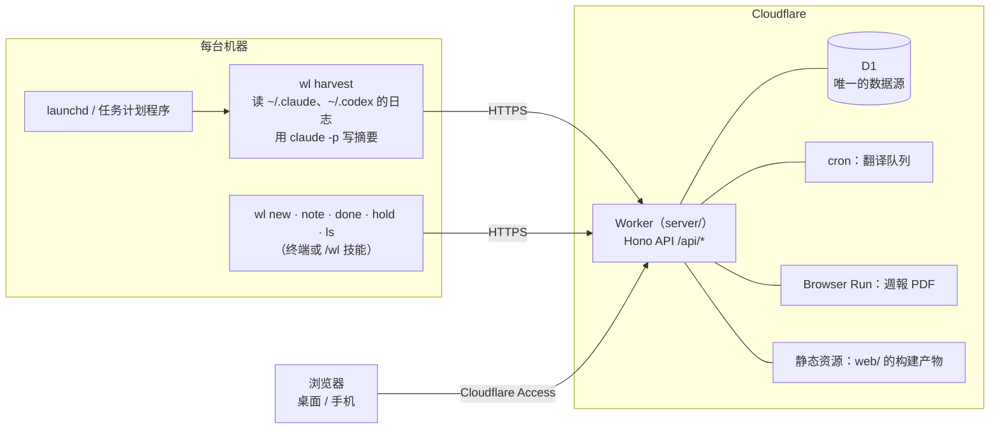

<div align="center">

<a href="https://hakupao.github.io/worklog-public/?lang=zh"></a>

# worklog

**自己会写的工作记录。**<br>
后台收集 Claude Code 和 Codex 的会话，自动挂到你正在做的案件上，
再整理成日文、中文、英文三种语言的週報。

<a href="https://hakupao.github.io/worklog-public/?lang=zh"></a>

[](https://github.com/hakupao/worklog-public/actions/workflows/ci.yml)
[](https://github.com/hakupao/worklog-public/actions/workflows/pages.yml)
[](LICENSE)


[English](README.md) · 简体中文 · [使用说明](docs/guide/usage.md) · [API](docs/guide/api.md)

</div>

> [!TIP]
> **演示站跑的就是真实的程序。** Worker 的代码直接在你的浏览器里运行，数据库是内存里的 SQLite，
> 装着八周虚构的工作：两台机器上的 434 个会话、15 个案件、计划、週報总结和周复盘，三种语言齐全。
> 时钟从 2026 年 10 月 15 日（周四）15:20 JST 开始走。随便点：改动只留在当前标签页，刷新就恢复原样。

## 两种外观，同一块看板

<table>
<tr>
<th width="50%">裏：LED 点阵</th>
<th width="50%">表：印刷</th>
</tr>
<tr>
<td><a href="https://hakupao.github.io/worklog-public/?world=ura&lang=zh#/v2/now"></a></td>
<td><a href="https://hakupao.github.io/worklog-public/?world=omote&lang=zh#/v2/now"></a></td>
</tr>
</table>

每一页都有两种外观，用底栏的「表 · 里」切换。「此刻」页显示正在运行的会话、接下来该做什么
（未关联的会话、今日安排、本周週報还没下载），今天的运行图，以及周末、发薪日、节假日的日程表；
上方的点阵场景图随一天中的时段变换。

## 一览

<table>
<tr>
<td width="50%"><a href="https://hakupao.github.io/worklog-public/?lang=zh#/v2/timeline"></a></td>
<td width="50%"><a href="https://hakupao.github.io/worklog-public/?lang=zh#/v2/plan"></a></td>
</tr>
<tr>
<td><b>时间线</b>：一周的所有会话在一块看板上，每个案件一条彩色线路。未关联的会话可以直接在这里挂到案件上。</td>
<td><b>计划</b>：每日、本周、近期、远期四档清单，加上今日安排。模型对照当天的会话判定完成、部分、未做。</td>
</tr>
<tr>
<td><a href="https://hakupao.github.io/worklog-public/?world=omote&lang=zh#/v2/tasks"></a></td>
<td><a href="https://hakupao.github.io/worklog-public/?world=omote&lang=ja#/v2/report"></a></td>
</tr>
<tr>
<td><b>案件</b>：依頼元、状态、按天和按周的工时，以及哪些案件此刻有会话在跑。</td>
<td><b>週報</b>：按案件、按天的总结，可直接修改的单元格，一页 A4 的 PDF 和跨周 xlsx，都有三种语言。</td>
</tr>
</table>

<a href="https://hakupao.github.io/worklog-public/?lang=zh#/v2/stats"></a>

**统计**：24 个视图，可以开关、排序：核心数字、每日瀑布图、并行会话、作息节奏、依頼元、token 用量和等价费用，
以及每周的 AI 复盘。

<table>
<tr>
<td width="34%"><a href="https://hakupao.github.io/worklog-public/?lang=ja#/m/now"></a></td>
<td width="34%"><a href="https://hakupao.github.io/worklog-public/?world=omote&lang=zh#/m/tl"></a></td>
<td>
<b>手机上</b><br><br>
窄屏有专门的界面：此刻、时间线、案件、计划、统计，开会间隙扫一眼就够。
<br><br>
每个画面都有中文、日本語、English，数据本身也会翻译：案件名、总结、备注都跟着语言走。
</td>
</tr>
</table>

> **为一个人的工作方式而写。** 它最初是给一位在日本做派遣的工程师用的：按委托记录工作，每周交一份日文週報。
> 数据模型、週報版式和不少界面用语都沿用这套做法，所以有些词保留日文：
> 案件 = 任务，依頼元 = 委托人，週報 = 周报，備考 = 备注栏，対応中 / 保留 / 完了 = 进行中 / 搁置 / 完成。
> 日期和周都按东京时间（JST）计算。

## 能做什么

- **收集会话。** `wl harvest` 读取 Claude Code（`~/.claude/projects`）和 Codex（`~/.codex/sessions`）的日志，
  每个会话发一条记录：活跃时长、写过的文件、token 用量、按 API 价格折算的等价费用（价格表在 `config.toml` 里），
  以及用 `claude -p` 写的简短摘要。
- **把会话挂到案件。** 按会话的工作目录（`config.toml` 的 `[projects]`）和日期匹配案件。匹配不上的留作「未关联」，
  到时间线上手动挂。
- **管理案件和计划。** 案件带依頼元、项目、备注和成果物。成果物可以手动添加，也会从会话写过的文件里自动识别。
  计划清单（每天 / 本周 / 近期 / 远期）和今日安排，harvest 时由模型对照当天的会话判定完成情况。
- **写週報。** 可直接改单元格的预览、每天和每周的 AI 总结、一页 A4 的 PDF（由 Cloudflare Browser Run 渲染，
  附编排页决定写哪些行、什么顺序），以及最多 52 周的跨周 xlsx。所有导出都有日文、中文、英文三种。
- **看统计。** 24 个可开关的视图（工时、节奏、依頼元、token 用量与费用），以及由 `wl review` 写的每周 AI 复盘。
- **三语界面**（中文 / 日本語 / EN）。Worker 用 Claude 翻译用户输入的文字，并把手输的文字稍作润色，原文保留。
  桌面界面有浅色和深色（LED 点阵）两种外观，另有一套手机界面。
- **Claude Code 的 `/wl` 技能**（可选）：不离开会话，用自然语言起票、补记、报完了。

## 架构



- D1 是唯一的数据源；本地只留采集器的书签和没发出去的写入（outbox）。
- 浏览器靠 Cloudflare Access 的会话认证，自己不持有任何 token。CLI 发送 Bearer token 和 Access 的 Service Token。

## 目录结构

| 路径 | 是什么 |
|------|--------|
| `collector/` | Go 写的 `wl`：日志解析、摘要、harvest、API 客户端。`make -C collector build` 把二进制放到 `bin/`。 |
| `server/` | Cloudflare Worker：Hono API、D1 迁移、週報生成（ExcelJS 出 xlsx，Browser Run 出 PDF）、cron 任务。 |
| `web/` | 网页界面：React、Vite、TanStack Query、ECharts。构建到 `server/public/`。 |
| `web/demo/` | 演示站：把 `server/src` 放在浏览器里运行，D1 换成 sql.js，数据由 `demo/seed/` 生成（全部虚构）。由 `.github/workflows/pages.yml` 发布到 GitHub Pages。 |
| `scripts/` | 定时任务的配置（launchd plist、任务计划程序脚本）、`/wl` 技能安装脚本、发版与更新脚本、本机写周报总结的脚本。 |
| `skills/wl/` | Claude Code `/wl` 技能的模板（由 `scripts/install-skill.*` 渲染）。 |
| `docs/` | `guide/`（使用说明与 API）和 `design/`（设计书）。 |
| `config.example.toml` | 配置样例，复制成 `config.toml` 使用。 |
| `.github/` | CI workflow、issue 与 PR 模板。 |

## 快速开始

需要：Cloudflare 账号（Workers、D1、Access；PDF 还要 Browser Run）、Node 24、Go（版本见 `collector/go.mod`），
要写摘要的话还要装好并登录 [Claude Code](https://claude.com/claude-code) CLI。

### 1. 部署 Worker

先给 Worker 要用的主机名配好 **Cloudflare Access**：建一个 self-hosted 应用，给自己的登录账号加 allow 策略；再建一个
Service Token，加一条 *Service Auth* 策略给 CLI 用。记下 team domain 和这个应用的 AUD 标签：Worker 用它们验证每一个
Access JWT，验证不了的直接拒绝。

然后在仓库里：

```bash
git clone https://github.com/hakupao/worklog-public.git
cd worklog/server
npm install
npx wrangler login
npx wrangler d1 create worklog          # 记下输出里的 database_id
```

按自己的账号修改 `server/wrangler.jsonc`：

- `routes`：你的主机名（例如 `worklog.example.com`），或者删掉 `routes` 直接用 `workers.dev` 的地址；
- `d1_databases[0].database_id`：`d1 create` 输出的 id；
- `vars.TEAM_DOMAIN`（`https://<team>.cloudflareaccess.com`）和 `vars.POLICY_AUD`（Access 应用的 AUD 标签）；
- `vars.DIGESTS_AUTO`：`"on"` 让 Worker 自己写週報总结；`"off"` 交给 `scripts/digests-local.mjs` 在本机写。

设置 secret 并部署：

```bash
npx wrangler secret put API_TOKEN          # 必需：CLI 用的 Bearer token
npx wrangler secret put ANTHROPIC_API_KEY  # 可选：翻译、润色、总结、PDF 文字
npm run deploy                             # 构建 web/、应用 D1 迁移（--remote）、部署
```

### 2. 构建 CLI

在仓库根目录：

```bash
make -C collector build                 # -> bin/wl
```

Windows 上用 `make -C collector build-windows` 构建，把产出的 `bin/wl-windows-amd64.exe` 改名为 `bin\wl.exe`；
或者用 `scripts/update-wl.ps1 -Tag <tag> -Dest bin -Repo <owner>/<repo>` 下载 Release。Release 由
`scripts/release-wl.sh` 发布。

### 3. 配置

```bash
cp config.example.toml config.toml
```

在 `config.toml` 里设置 `api_url`、`[requesters]`（依頼元别名）和 `[projects]`（绝对目录 → 项目名）。
`summarize_model` 是 `claude -p` 写摘要用的模型（默认 `haiku`）。
密钥和每台机器各自的值放在 `~/.worklog/` 下，绝不进仓库：

```toml
# ~/.worklog/credentials.toml
api_token = "..."
access_client_id = "..."        # Cloudflare Access 的 Service Token
access_client_secret = "..."
```

```toml
# ~/.worklog/local.toml（可选）
machine = "laptop"              # 覆盖 config.toml 的 machine；默认是主机名
```

`wl` 按这个顺序找 `config.toml`：`$WORKLOG_ROOT`，然后是当前目录及其上级，然后是二进制所在目录及其上级，
所以在任何目录下都能直接跑 `bin/wl`。`$WORKLOG_HOME` 可以替换 `~/.worklog`。

### 4. 第一次 harvest

```bash
bin/wl harvest
```

正常时退出码 0，最后一行形如 `new=12 updated=0 parked=0 skipped=3 fallback=0, unassigned=4`，网页顶栏出现这台机器的名字。
`fallback=N` 表示 `claude -p` 不可用，有 N 个会话只拿到了占位摘要。

### 5. 定时执行

没有常驻进程，靠定时任务跑 `wl harvest`。

- **macOS**：`scripts/com.worklog.harvest.plist` 在每小时的 0、15、30、45 分跑 `bin/wl harvest --tiered`。
  先把里面的占位路径（`ProgramArguments`、能找到 `claude` 的 `PATH`、`WORKLOG_ROOT`、`WorkingDirectory`）改成本机的，然后：

  ```bash
  cp scripts/com.worklog.harvest.plist ~/Library/LaunchAgents/
  launchctl load ~/Library/LaunchAgents/com.worklog.harvest.plist
  ```

- **Windows**：`scripts/schtasks-harvest.ps1` 注册计划任务 `WorklogHarvest`，每小时 0 分跑一次全量的
  `bin\wl.exe harvest`，不弹窗。输出追加到 `%USERPROFILE%\.worklog\harvest.log`。

`--tiered` 是给每 15 分钟一次的定时任务用的。每一轮只读变过的日志，只做到期的工作：

| 档 | 工作 |
|----|------|
| 15 分钟 | 发出 outbox、发送变过的会话、给新会话写摘要、心跳 |
| 1 小时 | 给进行中的会话重写摘要（停下后再写一次）、今天的计划判定、成果物判定 |
| 1 天 | 昨天的最终计划判定、完整重扫最近 14 天 |
| 1 周 | 每周复盘 |

没有变化的一轮不调用 `claude`。不带参数的 `wl harvest` 读全部日志、做全部工作。详见
[`docs/design/2026-10-20-tiered-harvest-design.md`](docs/design/2026-10-20-tiered-harvest-design.md)。

### 6. 可选：`/wl` 技能

```bash
./scripts/install-skill.sh          # macOS（需要 bin/wl）
.\scripts\install-skill.ps1         # Windows PowerShell（需要 bin\wl.exe）
```

脚本把 `skills/wl/SKILL.template.md` 填上本机仓库的路径，写成 `~/.claude/skills/wl/SKILL.md`。挪了仓库或改了模板后要重跑一次。

## CLI

| 命令 | 作用 |
|------|------|
| `wl new 依頼元 案件名 [--project P] [--received YYYY-MM-DD]` | 起票，显示服务端采番的 ID（`T20260918-01`）。 |
| `wl note TASK_ID 正文 [--minutes N]` | 加一条备注，并追加到案件的 備考。`TASK_ID` 写 `-` 表示不挂案件。 |
| `wl done TASK_ID [--deliverable PATH]... [--hours H]` | 标记完了。 |
| `wl hold TASK_ID` | 转为保留。 |
| `wl ls [--all]` | 列出対応中和保留的案件（`--all` 含完了）。 |
| `wl harvest [--tiered] [--since 天数] [--claude-root PATH] [--codex-root PATH]` | 收集会话日志并上报。`--since` 默认 14 天。 |
| `wl harvest --refresh-meta [--since 天数]` | 只更新已上报会话的写过的文件、token 用量和费用。 |
| `wl review [--week YYYY-Www] [--force]` | 写每周 AI 复盘（默认上一周）。 |
| `wl plan judge [--date YYYY-MM-DD]` | 立即对照当天的会话判定今日安排（默认今天）。 |

会话与案件的关联、编辑和週報都在网页上做。

**写入的行为。** 所有写入都直接发给 API。

- `wl new`、`wl done`、`wl hold` 要么写到服务端，要么退出码 1。它们从不排队，所以报错就意味着什么都没变。
- 服务端连不上时，`wl note` 暂存到 `~/.worklog/outbox/`，下次 `wl harvest` 时发出。发不出去的会话也同样暂存（`parked=N`）。
  被服务端拒收的写入移到 `outbox/rejected/`，不再重发。
- `wl harvest` 读不到案件列表时退出码 2（否则会把所有会话都当成未关联发出去）。另一个 harvest 持有
  `~/.worklog/harvest.lock` 时也是退出码 2；带 `--tiered` 时这种情况退出码 0。
- 从读案件到写回之间没有版本检查，这一瞬间在网页上的编辑可能被覆盖。

## 网页界面

| 页面 | 桌面 | 手机 |
|------|------|------|
| 此刻：运行中的会话、下一步、今日安排 | `#/v2/now` | `#/m/now` |
| 时间线：按天看会话，挂到案件或解绑 | `#/v2/timeline` | `#/m/tl` |
| 案件 | `#/v2/tasks` | `#/m/tasks` |
| 计划与今日安排 | `#/v2/plan` | `#/m/plan` |
| 週報；PDF 编排页在 `#/v2/report/<週>/pdf` | `#/v2/report` | |
| 统计与每周复盘 | `#/v2/stats` | `#/m/stats` |
| 使用说明（由 `docs/guide/usage.md` 渲染） | `#/v2/usage` | |
| 设置（存在服务端，所有浏览器共用） | `#/v2/settings` | |

宽度不超过 700 px 的屏幕会跳到手机界面，可以切回桌面界面。各页的详细说明见 [`docs/guide/usage.md`](docs/guide/usage.md)。

## 本地状态

| 路径 | 内容 |
|------|------|
| `~/.worklog/credentials.toml` | `api_token` 和 Access 的 Service Token |
| `~/.worklog/local.toml` | 这台机器的 `machine` 名 |
| `~/.worklog/harvest_state.json` | harvest 的书签（每台机器各自独立）。删掉后会重扫最近 14 天；服务端按会话 id 去重。 |
| `~/.worklog/collector_state.json`、`tiers.jsonl`、`harvest.lock` | 分档 harvest 的缓存、决定日志和锁 |
| `~/.worklog/outbox/` | 还没发出去的写入；`rejected/` 里是被服务端拒收的 |

## 开发

CI 跑四套测试：Go 采集器、Worker（在本地 workerd 上跑 vitest）、网页（vitest，并在多个时区下复跑）和 Node 脚本。
本地开发（`wrangler dev`、Vite 代理、种数据）、测试和提交规范见 [`CONTRIBUTING.md`](CONTRIBUTING.md)（英文）。

演示站不需要 Cloudflare 账号，本地就能构建和运行：

```bash
cd web
npm run build:demo    # 先生成 demo.sqlite，再构建 dist-demo/
npm run preview:demo  # http://localhost:4174/worklog-public/
npm run smoke:demo    # 对构建好的站点逐页打开、逐个 GET 路由检查
```

## 文档

- [`docs/guide/usage.md`](docs/guide/usage.md)：日常用法、各页说明、排错、新机器怎么装。
- [`docs/guide/api.md`](docs/guide/api.md)：全部 API 路由（英文）。
- [`docs/design/`](docs/design/)：按日期命名的设计书，一个功能一份。

## 许可证

MIT，见 [`LICENSE`](LICENSE)。第三方依赖、随包分发的字体和图标、外部服务及其许可证列在 [`THIRD_PARTY.md`](THIRD_PARTY.md)。
